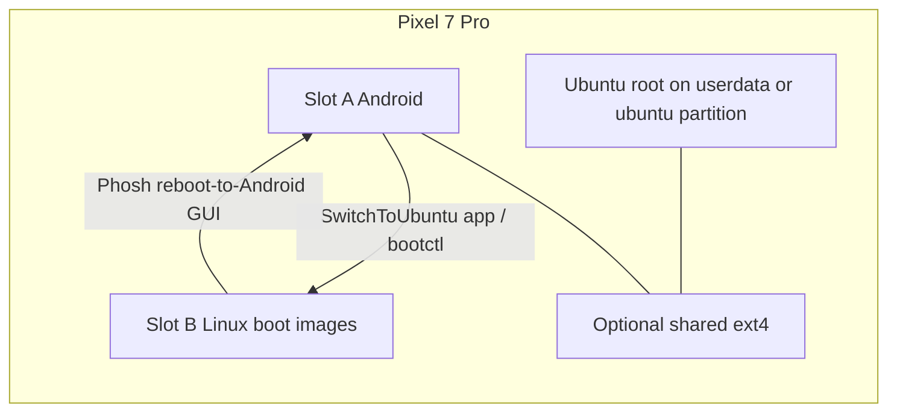

# Architecture

- Bootloader stays unlocked. AVB is orange / unrestricted for unsigned slot-B images.
- Flash allowlist (boot scripts): `boot_b`, `init_boot_b`, `vendor_boot_b`,
  `vendor_kernel_boot_b`, `dtbo_b`, `userdata` only.
- Shared partition tooling finds partitions by GPT **name** (`userdata`, `ubuntu`,
  `shared`) and refuses to format Android/Ubuntu roots. Sector numbers in older
  notes are **examples** for one cheetah layout — always verify on your device.
- USB SSH: nftables allowlist form (accept ssh on `usb0`/`lo`, drop ssh elsewhere).
